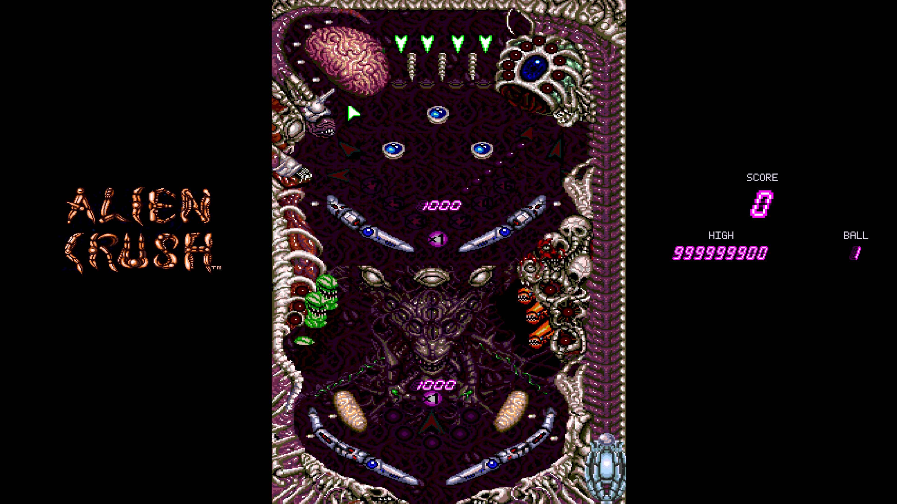

# Alien Crush Port

An unofficial PC port of the 1988 TurboGrafx-16 pinball game *[Alien Crush](https://en.wikipedia.org/wiki/Alien_Crush)*, built to be played on a virtual pinball cabinet.

It plays like the original game, with some additional features:

* Cabinet mode shows the whole table at once, with the playfield, backglass, and score in their own windows
* Both halves of the table stay active in cabinet mode, instead of only the half the ball is in
* Smoother motion on high refresh rate displays
* Analog plunger and accelerometer nudging (verified working on PinOne boards)
* Adjustable nudge strength
* Music keeps all of its parts while sound effects play
* High scores are saved between sessions
* Start the game in any bonus stage

## ROM (Required)

No game data is included.

You will need to obtain a copy of the original ROM:

| | |
| --- | --- |
| Size | 262,144 bytes |
| MD5 | `0088d1d20861490677edb147d2de60bd` |
| SHA-1 | `1bfa4b5139612b0c33e3282c23e56c1dfc08ed52` |
| SHA-256 | `1af27c808be34e0c2fe435c169f5169417d6362dee0e928413581a1f6126557f` |

## Playing

Run `alien-crush-launcher.exe`.

Choose your ROM file under game settings, change any other setting you like, then press **Play**.

| Input | Action |
| --- | --- |
| Left Shift / Left / left shoulder | Left flipper |
| Right Shift / Right / right shoulder | Right flipper |
| Enter / gamepad Start | Launch the ball (hold to draw, release to fire), start, pause |
| Space | Nudge |
| F5 / F9 | Quick save / quick load |
| Escape | Exit |

## Port Progress

The port is fully playable, but is a work in progress.

The game still runs on emulated PC Engine hardware. The cabinet's full-table picture, and the half of the table the ball is not in, are native C++ validated against original ROM execution.

## Credits

* [Beetle PCE](https://github.com/libretro/beetle-pce-libretro) - used to emulate the original hardware
* [Mesen](https://github.com/SourMesen/Mesen2) - used to validate the port
* [SDL](https://github.com/libsdl-org/SDL) - windows, input and audio
* [stb](https://github.com/nothings/stb) - launcher text
